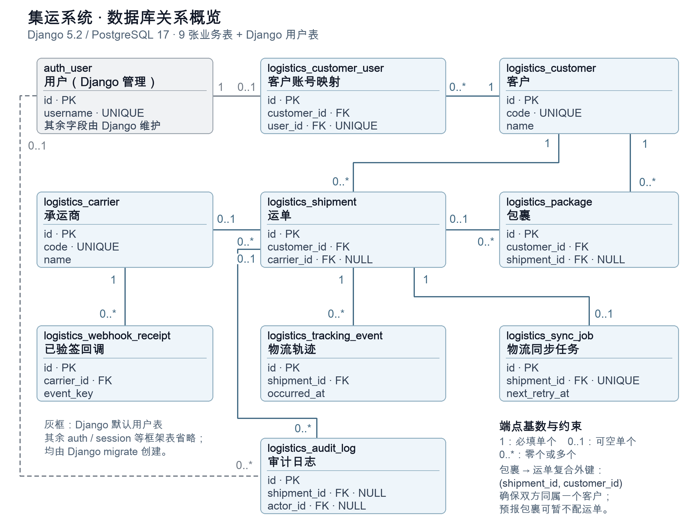

# 集运系统数据库表结构与 SQL 操作说明

本手册供后端开发与数据库维护人员查阅，覆盖 PostgreSQL 17 的 9 张业务表、96 个字段、客户隔离约束，以及可复现的查询与事务写入示例。Django 5.2 模型与迁移是结构的维护入口，推荐使用 migrate 建表。

### 交付文件与使用顺序

| 项目文件 | 用途 |
| --- | --- |
| backend/logistics/models.py | 字段、关系、状态与业务检查的权威模型 |
| backend/logistics/migrations/ | 0001 初始结构；0002 客户一致性；0003 中文名称；0004 预报幂等键 |
| db/schema.sql | 完整 PostgreSQL 结构及 Django 基础数据，仅用于全新隔离审阅库 |
| db/business_schema.sql | 业务迁移 SQL 审阅版；依赖先有 Django 框架表 |
| db/demo_data.sql | 本地示例数据；2 客户 7 运单 26 轨迹 |
| db/queries.sql | 客户范围只读查询与数据库结构检查 |
| db/operations.sql | 预报 轨迹 任务 回调写入演示；每段 ROLLBACK |

推荐路径：先配置独立开发数据库与环境变量，再在 backend 目录执行 python manage.py migrate，随后按需载入 demo_data.sql。SQL 审阅路径：仅在全新空库导入完整 schema.sql；它包含 django_migrations、content type 与 permission 基础数据，无用户及业务数据。两条路径二选一，不能在已建表数据库重复导入结构。

完整 schema 已在 PostgreSQL 17 的空库中恢复，并通过 migrate --check；示例查询及 operations.sql 也已实际执行验证。结构变化继续创建迁移，不直接修改已应用迁移或用手工 SQL 替代发布迁移。

## 1 业务关系与存储约定



图 1 业务实体与端点基数  框架表仅显示 auth_user

客户可有多个账号；账号最多属于一个客户。包裹在预报阶段可不绑定运单，一旦绑定必须与运单属于同一客户。运单可暂未指定承运商，并可有多条轨迹与审计记录；同步任务最多一条。

业务主键是 bigint identity；Django 内置 auth_user.id 是 integer，对应 user_id 与 actor_id 也是 integer。timestamptz 是 timestamp with time zone 的 PostgreSQL 别名。应用 USE_TZ=True、TIME_ZONE=UTC，界面按业务时区显示；日期型 ETA 不包含时区。

## 2 字段字典的默认值与删除语义

字段表中的可空指 SQL NULL，不等同于 Django blank=True。文本字段允许空白时通常保存空字符串。除主键 identity 外，当前迁移没有为业务字段保留服务器默认值；表内的 ORM 默认值只在 Django 创建对象时生效。

带 auto_now_add 的 created_at 或 received_at，以及带 auto_now 的 updated_at，均由 ORM 赋值，不是 PostgreSQL DEFAULT now() 或触发器。裸 INSERT 必须提供必填时间、JSON、布尔及状态值；更新 SQL 必须显式写 updated_at。ORM bulk_update 与 QuerySet.update 也不自动执行 auto_now。字段表的 FK 目标省略 logistics_ 前缀，auth_user 保留全名。

### logistics_customer

客户是隔离边界。is_active=False 时，客户 API 拒绝该客户账号读取业务数据。联系字段 blank=True 表示表单允许空字符串，不表示数据库允许 NULL。

| 字段 | PG 类型 | 可空 | 默认与键 | 中文用途 |
| --- | --- | --- | --- | --- |
| id | bigint | 否 | PK；DB identity | 内部主键；授权仍须校验客户 |
| created_at | timestamptz | 否 | ORM 首次保存时间 | 创建时间，由 ORM 首次保存赋值 |
| updated_at | timestamptz | 否 | ORM 保存时间 | 最后修改时间，由 ORM 保存时更新 |
| code | varchar(32) | 否 | UNIQUE；无默认 | 稳定业务代码 |
| name | varchar(120) | 否 | 无默认 | 显示名称 |
| email | varchar(254) | 否 | ORM 空值 '' | 联系邮箱；无值时用空字符串 |
| phone | varchar(40) | 否 | ORM 空值 '' | 联系电话；无值时用空字符串 |
| is_active | boolean | 否 | ORM True | 是否启用当前对象 |

### logistics_customer_user

一名用户最多属于一个客户；同一客户可关联多名用户。user_id 的数据库类型是 integer，匹配 Django 内置 auth_user.id；本表主键仍为 bigint。

| 字段 | PG 类型 | 可空 | 默认与键 | 中文用途 |
| --- | --- | --- | --- | --- |
| id | bigint | 否 | PK；DB identity | 内部主键；授权仍须校验客户 |
| customer_id | bigint | 否 | FK → customer.id；无默认 | 所属客户；服务端用于数据隔离 |
| user_id | integer | 否 | FK → auth_user.id；UNIQUE；无默认 | Django 用户；一个账号只能映射一个客户 |
| created_at | timestamptz | 否 | ORM 首次保存时间 | 创建时间，由 ORM 首次保存赋值 |

## 3 承运商与账号关系

### logistics_carrier

承运商配置与业务数据分离。api_base_url 是地址，访问密钥从受限环境配置或密钥服务注入，不增设明文密钥字段。真实承运商适配尚未交付。

| 字段 | PG 类型 | 可空 | 默认与键 | 中文用途 |
| --- | --- | --- | --- | --- |
| id | bigint | 否 | PK；DB identity | 内部主键；授权仍须校验客户 |
| created_at | timestamptz | 否 | ORM 首次保存时间 | 创建时间，由 ORM 首次保存赋值 |
| updated_at | timestamptz | 否 | ORM 保存时间 | 最后修改时间，由 ORM 保存时更新 |
| code | varchar(32) | 否 | UNIQUE；无默认 | 稳定业务代码 |
| name | varchar(120) | 否 | 无默认 | 显示名称 |
| api_base_url | varchar(200) | 否 | ORM 空值 '' | 承运商 API 地址；不存 API 密钥 |
| is_active | boolean | 否 | ORM True | 是否启用当前对象 |

### 主键 唯一键与外键

所有 PostgreSQL 外键使用 ON UPDATE NO ACTION 和 ON DELETE NO ACTION。PROTECT、CASCADE、SET_NULL 是 Django 删除收集器行为，直接 SQL DELETE 不会据此级联。常规 Django FK 为 DEFERRABLE INITIALLY DEFERRED；0002 复合 FK 为 NOT DEFERRABLE。

客户和承运商的 code 分别全局唯一。CustomerUser.customer_id 指向 logistics_customer.id，ORM 为 PROTECT；user_id 指向 auth_user.id 并有 UNIQUE，ORM 为 CASCADE。创建第二条相同 user_id 的客户映射会被数据库拒绝。

Shipment.customer_id 与 carrier_id 均使用 ORM PROTECT；Package.customer_id 与 shipment_id 同样为 PROTECT。客户或承运商仍被引用时，应用层拒绝删除；数据库外键也阻止留下悬空记录。

### 框架表与共享 Session

auth_user、auth_group、auth_permission、auth_user_groups、auth_user_user_permissions、auth_group_permissions、django_content_type、django_session、django_admin_log 与 django_migrations 由 Django migrate 创建和维护。密码使用 Django 哈希与验证流程，不手写认证表或明文密码。

Session 引擎为 django.contrib.sessions.backends.db。多应用实例共享同一个数据库与稳定 SECRET_KEY；会话不存本机文件或进程缓存。数据库账号密码和 SECRET_KEY 是部署配置，不属于业务表字段。

## 4 运单字段与收件信息

### logistics_shipment

主表保存面向查询的当前状态投影；轨迹表保存发生过的事件。由客户归属、当前状态和更新时间支持客户列表，不靠浏览器传入 customer_id 决定授权。

| 字段 | PG 类型 | 可空 | 默认与键 | 中文用途 |
| --- | --- | --- | --- | --- |
| id | bigint | 否 | PK；DB identity | 内部主键；授权仍须校验客户 |
| created_at | timestamptz | 否 | ORM 首次保存时间 | 创建时间，由 ORM 首次保存赋值 |
| updated_at | timestamptz | 否 | ORM 保存时间 | 最后修改时间，由 ORM 保存时更新 |
| number | varchar(32) | 否 | UNIQUE；无默认 | 内部运单业务编号，全局唯一 |
| customer_id | bigint | 否 | FK → customer.id；无默认 | 所属客户；服务端用于数据隔离 |
| carrier_id | bigint | 是 | FK → carrier.id；无默认；可省略为 NULL | 关联承运商 |
| carrier_account | varchar(64) | 否 | ORM 空值 '' | 承运商账号范围标识；不是凭据 |
| tracking_number | varchar(80) | 否 | ORM 空值 '' | 承运商追踪单号；可为空字符串 |
| goods_summary | varchar(200) | 否 | 无默认 | 运单货物概述 |
| transport_method | varchar(32) | 否 | 无默认 | 运输方式文本，如海运专线 |
| origin_country | varchar(80) | 否 | 无默认 | 起运国家或地区 |
| origin_city | varchar(80) | 否 | 无默认 | 起运城市 |
| destination_country | varchar(80) | 否 | 无默认 | 目的国家或地区 |
| destination_city | varchar(80) | 否 | 无默认 | 目的城市 |
| recipient_name | varchar(80) | 否 | 无默认 | 收件人姓名 |
| recipient_phone | varchar(40) | 否 | 无默认 | 收件人电话 |

number 与数据库内部 id 含义不同。number 是可显示的唯一业务编号，示例为 PL20261118001；tracking_number 是承运商单号。当前业务模型仅限制长度与唯一性，未用正则约束编号格式。

## 5 运单度量 时间与完整性

### logistics_shipment

| 字段 | PG 类型 | 可空 | 默认与键 | 中文用途 |
| --- | --- | --- | --- | --- |
| recipient_address | text | 否 | 无默认 | 收件地址；按敏感个人信息保护 |
| status | varchar(16) | 否 | ORM 'warehouse' | 对象状态，取值见状态字典 |
| pieces | integer | 否 | ORM 1 | 件数；必须大于零 |
| weight_kg | numeric(10,3) | 是 | 无默认；可省略为 NULL | 重量，单位 kg；未知可空 |
| volume_cbm | numeric(10,4) | 是 | 无默认；可省略为 NULL | 体积，单位 m³；未知可空 |
| estimated_delivery_date | date | 是 | 无默认；可省略为 NULL | 预计送达日期；不是实际签收时间 |
| delivered_at | timestamptz | 是 | 无默认；可省略为 NULL | 实际签收时间；仅 delivered 状态有值 |
| current_location | varchar(200) | 否 | ORM 空值 '' | 最近已应用轨迹的扫描地点 |
| latest_event_at | timestamptz | 是 | 无默认；可省略为 NULL | 主表当前状态对应的事件发生时间 |

| 约束或规则 | 数据库含义 |
| --- | --- |
| shipment_status_valid | status 必须在六种运单状态内 |
| shipment_pieces_positive | pieces > 0；PositiveIntegerField 另有非负 CHECK |
| shipment_weight_nonnegative | weight_kg 为空或 ≥ 0 |
| shipment_volume_nonnegative | volume_cbm 为空或 ≥ 0 |
| shipment_delivery_time_matches | delivered 状态必须有 delivered_at；其他状态必须为空 |
| shipment_tracking_requires_carrier | tracking_number 非空字符串时 carrier_id 必填 |
| shipment_carrier_tracking_unique | carrier_id 非空且 tracking_number 非空时，承运商 账号 单号三列组合唯一 |
| shipment_id_customer_unique | UNIQUE(id, customer_id)，作为包裹复合 FK 的被引用候选键 |

estimated_delivery_date 是承诺或估算日期，delivered_at 是实际签收时间。签收状态与签收时间由数据库 CHECK 保持一致。手工修正状态应追加轨迹及审计，避免只改主表状态而丢失原因。

## 6 包裹与客户预报

### logistics_package

预报可暂不分配运单，shipment_id=NULL 且 status=prealert。预报成功不代表入库；授权运营确认收货后才写 received_at 与 received。当前预报 API 将运输方式 method 和目的地 destination 拼入 description，没有独立同名字段。

| 字段 | PG 类型 | 可空 | 默认与键 | 中文用途 |
| --- | --- | --- | --- | --- |
| id | bigint | 否 | PK；DB identity | 内部主键；授权仍须校验客户 |
| created_at | timestamptz | 否 | ORM 首次保存时间 | 创建时间，由 ORM 首次保存赋值 |
| updated_at | timestamptz | 否 | ORM 保存时间 | 最后修改时间，由 ORM 保存时更新 |
| customer_id | bigint | 否 | FK → customer.id；无默认 | 所属客户；服务端用于数据隔离 |
| shipment_id | bigint | 是 | FK → shipment.id；无默认；可省略为 NULL | 关联运单 |
| prealert_number | varchar(32) | 否 | UNIQUE；无默认 | 预报业务编号，全局唯一 |
| submission_key | varchar(64) | 是 | 无默认；可省略为 NULL | 客户范围内预报幂等键；旧数据可空 |
| domestic_tracking_number | varchar(80) | 否 | ORM 空值 '' | 国内快递单号；可为空字符串 |
| description | varchar(200) | 否 | 无默认 | 包裹内容；当前 API 附运输方式和目的地 |
| pieces | integer | 否 | ORM 1 | 件数；必须大于零 |
| weight_kg | numeric(10,3) | 是 | 无默认；可省略为 NULL | 重量，单位 kg；未知可空 |
| status | varchar(16) | 否 | ORM 'prealert' | 对象状态，取值见状态字典 |
| received_at | timestamptz | 是 | 无默认；可省略为 NULL | 实际入库时间；预报时为空 |

| 约束或规则 | 数据库含义 |
| --- | --- |
| package_customer_submission_unique | submission_key 非 NULL 且非空字符串时，UNIQUE(customer_id, submission_key)；重试复用同一预报 |
| package_status_valid | status 仅 prealert received packed |
| package_pieces_positive | pieces > 0；另有非负 CHECK |
| package_weight_nonnegative | weight_kg 为空或 ≥ 0 |
| package_packed_requires_shipment | packed 必须绑定 shipment_id |
| package_shipment_customer_fk | (shipment_id, customer_id) → shipment(id, customer_id)；禁止跨客户绑定；NOT DEFERRABLE |

## 7 物流轨迹与事件去重

### logistics_tracking_event

occurred_at 是扫描发生时间，received_at 是系统接收时间。人工更新服务在事务中锁定运单主行，先去重再追加轨迹，仅将不早于 latest_event_at 的事件应用到主表。shipment 的 ORM 删除行为为 CASCADE。

| 字段 | PG 类型 | 可空 | 默认与键 | 中文用途 |
| --- | --- | --- | --- | --- |
| id | bigint | 否 | PK；DB identity | 内部主键；授权仍须校验客户 |
| shipment_id | bigint | 否 | FK → shipment.id；无默认 | 关联运单 |
| source | varchar(16) | 否 | 无默认 | 来源 manual poll webhook |
| source_key | varchar(128) | 否 | 无默认 | 同一运单范围内的稳定事件去重键 |
| status | varchar(16) | 否 | 无默认 | 对象状态，取值见状态字典 |
| title | varchar(100) | 否 | 无默认 | 轨迹标题 |
| description | text | 否 | 无默认 | 轨迹详情及人工操作说明 |
| location | varchar(200) | 否 | 无默认 | 轨迹扫描地点文本 |
| occurred_at | timestamptz | 否 | 无默认 | 事件实际发生时间，含时区 |
| received_at | timestamptz | 否 | ORM 首次保存时间 | 系统接收时间；ORM 首次保存赋值 |
| raw_status | varchar(80) | 否 | ORM 空值 '' | 承运商原始状态文本；可为空字符串 |
| latitude | numeric(9,6) | 是 | 无默认；可省略为 NULL | 纬度；与经度同时有值或同时为空 |
| longitude | numeric(9,6) | 是 | 无默认；可省略为 NULL | 经度；与纬度同时有值或同时为空 |

| 约束或规则 | 数据库含义 |
| --- | --- |
| tracking_event_dedup_unique | UNIQUE(shipment_id, source_key)；source 不属于唯一键 |
| tracking_event_source_valid | source 仅 manual poll webhook |
| tracking_event_status_valid | status 必须在六种运单状态内 |
| tracking_event_coordinates_valid | 经纬度均空，或均非空且纬度 [-90,90] 经度 [-180,180] |

调用人工事件服务时，同 source_key 且内容一致返回已有事件；同键不同内容抛出 EventConflict。数据库唯一键负责最终防重，服务负责检查内容一致性。轮询和 Webhook 应按提供商稳定 ID 或统一指纹生成键，避免相同事件跨来源重复。

## 8 已验签回调

### logistics_webhook_receipt

仅允许未来承运商适配器在完成验签、防重放和请求体检查后写入。表结构已经建立；真实 HTTPS 验签入口与承运商处理 worker 尚未交付。carrier 的 ORM 删除行为为 PROTECT。

| 字段 | PG 类型 | 可空 | 默认与键 | 中文用途 |
| --- | --- | --- | --- | --- |
| id | bigint | 否 | PK；DB identity | 内部主键；授权仍须校验客户 |
| carrier_id | bigint | 否 | FK → carrier.id；无默认 | 关联承运商 |
| event_key | varchar(128) | 否 | 无默认 | 承运商范围内的回调去重键 |
| payload | jsonb | 否 | ORM {} | 验签后的 JSON 正文；限制敏感信息保留 |
| received_at | timestamptz | 否 | ORM 首次保存时间 | 系统接收时间；ORM 首次保存赋值 |
| processed_at | timestamptz | 是 | 无默认；可省略为 NULL | 回调处理完成时间；未处理可空 |
| status | varchar(16) | 否 | ORM 'pending' | 对象状态，取值见状态字典 |
| attempt_count | integer | 否 | ORM 0 | 处理或同步尝试次数；非负整数 |
| last_error | text | 否 | ORM 空值 '' | 最近错误摘要；不记录密钥或完整敏感正文 |

| 约束或规则 | 数据库含义 |
| --- | --- |
| webhook_carrier_event_unique | UNIQUE(carrier_id, event_key) |
| webhook_receipt_status_valid | status 仅 pending processed failed；attempt_count 有非负 CHECK |

### 验签与正文保留

event_key 在承运商范围内唯一，抵御服务商重试导致重复入库。SQL INSERT 本身不能验证网络请求签名；验签、时间窗、防重放及体积限制必须由接入适配器在入库前执行。

payload 可能包含电话、地址及承运商标识。正式接入前需确定保留天数、授权角色、脱敏方式及定期删除策略，区分原始正文与需长期保留的业务轨迹。当前未交付自动清理任务，不能将日志或备份视为无限期正文存储。

## 9 同步任务与多实例认领

### logistics_sync_job

一个运单最多有一个同步任务，shipment 的 ORM 删除行为为 CASCADE。任务表与队列索引已经建立；真实承运商同步 worker 尚未交付。operations.sql 的租约认领与回收是可执行演示，不能视为已有调度服务。

| 字段 | PG 类型 | 可空 | 默认与键 | 中文用途 |
| --- | --- | --- | --- | --- |
| id | bigint | 否 | PK；DB identity | 内部主键；授权仍须校验客户 |
| created_at | timestamptz | 否 | ORM 首次保存时间 | 创建时间，由 ORM 首次保存赋值 |
| updated_at | timestamptz | 否 | ORM 保存时间 | 最后修改时间，由 ORM 保存时更新 |
| shipment_id | bigint | 否 | FK → shipment.id；UNIQUE；无默认 | 关联运单 |
| status | varchar(16) | 否 | ORM 'pending' | 对象状态，取值见状态字典 |
| attempt_count | integer | 否 | ORM 0 | 处理或同步尝试次数；非负整数 |
| next_retry_at | timestamptz | 否 | ORM 当前时间 | 到期可执行或重试时间 |
| locked_until | timestamptz | 是 | 无默认；可省略为 NULL | 运行租约截止时间；running 时必须有值 |
| last_success_at | timestamptz | 是 | 无默认；可省略为 NULL | 上次同步成功时间 |
| last_error | text | 否 | ORM 空值 '' | 最近错误摘要；不记录密钥或完整敏感正文 |

| 约束或规则 | 数据库含义 |
| --- | --- |
| 唯一键 | shipment_id UNIQUE，运单与任务为一对零或一 |
| sync_job_status_valid | status 仅 pending running succeeded failed；attempt_count 有非负 CHECK |
| sync_job_lock_matches_status | running 必须有 locked_until；其他状态必须为空 |

operations.sql 使用 FOR UPDATE SKIP LOCKED 认领到期任务，并设置 locked_until。多 worker 可取得不同任务；worker 必须保留返回的租约截止值作为令牌，完成与续租时核对该值，过期 worker 不得再发布结果。

回收语句将过期 running 任务变为 failed、清空 locked_until 并推迟 next_retry_at。示例事务以 ROLLBACK 结束，仅演示结构可支持的执行模式；生产还需实际承运商适配、超时、退避、限流、令牌校验与监控。

## 10 审计与索引

### logistics_audit_log

记录动作、操作者及结构化摘要。人工轨迹服务把详细说明留在关联轨迹，审计只保存事件 ID、前后状态和是否更新投影，避免重复存放个人信息。

| 字段 | PG 类型 | 可空 | 默认与键 | 中文用途 |
| --- | --- | --- | --- | --- |
| id | bigint | 否 | PK；DB identity | 内部主键；授权仍须校验客户 |
| actor_id | integer | 是 | FK → auth_user.id；无默认；可省略为 NULL | 操作用户；系统操作或已删用户可空 |
| shipment_id | bigint | 是 | FK → shipment.id；无默认；可省略为 NULL | 关联运单 |
| action | varchar(64) | 否 | 无默认 | 审计动作代码 |
| reason | text | 否 | ORM 空值 '' | 操作原因；可为空字符串 |
| changes | jsonb | 否 | ORM {} | 结构化变更摘要；避免复制敏感信息 |
| created_at | timestamptz | 否 | ORM 首次保存时间 | 创建时间，由 ORM 首次保存赋值 |

actor_id 引用 auth_user.id，ORM 删除为 SET_NULL；shipment_id 可空且 ORM 为 PROTECT。直接 SQL 删除仍受 NO ACTION 外键限制。action 当前无数据库枚举约束，调用方需使用一致的动作代码。

### 显式业务索引

| 索引名 | 列与用途 |
| --- | --- |
| ship_cust_status_updated_idx | customer_id, status, updated_at DESC；客户状态列表 |
| ship_customer_updated_idx | customer_id, updated_at DESC；客户最近更新列表 |
| event_shipment_timeline_idx | shipment_id, occurred_at DESC, id DESC；稳定轨迹时间线 |
| webhook_pending_queue_idx | status, received_at；待处理回调队列 |
| sync_job_retry_queue_idx | status, next_retry_at；到期重试任务 |
| audit_shipment_created_idx | shipment_id, created_at DESC；运单审计查询 |

主键、UNIQUE、外键字段及 varchar 模式匹配还会形成 Django 自动索引。最终索引定义与外键名称以 db/schema.sql 或 pg_indexes 查询为准；不要仅按 ER 图推断。

## 11 状态 编号与示例数据

### 运单及轨迹状态

| 数据库值 | 中文含义 |
| --- | --- |
| warehouse | 待出库 |
| shipped | 已发货 |
| transit | 运输中 |
| customs | 清关中 |
| delivery | 派送中 |
| delivered | 已签收 |

| 对象 | 合法状态或来源 |
| --- | --- |
| 包裹 status | prealert 已预报；received 已入库；packed 已装箱 |
| 轨迹 source | manual 人工录入；poll 主动查询；webhook 承运商推送 |
| 回调 status | pending 待处理；processed 已处理；failed 失败 |
| 同步 status | pending 待执行；running 执行中；succeeded 已成功；failed 失败 |

### 编号与演示账号

客户 code 示例 DEMO-A 与 DEMO-B；承运商 code 为 DEMO。运单 PL20261118001 至 PL20261118007 共 7 条，A 客户 6 条、B 客户 1 条。示例预报号 PA-PL20261118001 与运单业务号相关联；当前预报 API 生成 PRE 加 UTC 日期与随机后缀，均非数据库格式规则。

demo_data.sql 创建 db_demo_a、db_demo_b 和 db_operator 三个禁用密码账号。前两个是客户账号，db_operator 是仅供本地样例操作的超级管理员；禁用密码表示不能直接登录，SQL 的 is_active 过滤仍可用于示例数据查询。

```sql
cd backend
python manage.py changepassword db_demo_a
python manage.py changepassword db_demo_b
python manage.py changepassword db_operator
```

只在本地样例需要登录时分别设置密码。生产使用独立账号与最小权限，不部署样例超级管理员。

### 预报提交重试

预报 API 必传 submissionKey，长度不超过 64 且为有效 UUID。首次创建返回 201；同客户同键且内容一致返回原预报和 200；同键不同内容返回 409。历史行可为 NULL，条件唯一索引只约束非空键；前端超时重试必须保留原键。

## 12 建表与客户范围查询

### 初始化执行顺序

```sql
# 路径 A 推荐  在 backend 目录
python manage.py migrate
# 路径 B 仅全新隔离空库  在项目根目录
psql "$REVIEW_DATABASE_URL" -v ON_ERROR_STOP=1 -f db/schema.sql
# 二选一完成结构后  按需载入本地示例
psql "$REVIEW_DATABASE_URL" -v ON_ERROR_STOP=1 -f db/demo_data.sql
psql "$REVIEW_DATABASE_URL" -v ON_ERROR_STOP=1 -f db/queries.sql
```

REVIEW_DATABASE_URL 指向隔离数据库，凭据从受限环境注入。完整 schema 已含迁移记录，导入后 migrate 应识别为已应用；migrate --check 可用于检查是否存在待应用迁移。business_schema.sql 是审阅版，不包含先决框架结构，不能当作完整建库文件。

### 按登录账号查询客户运单

```sql
SELECT s.number, s.status, s.goods_summary, s.current_location,
       s.latest_event_at, s.estimated_delivery_date, s.delivered_at
FROM logistics_shipment AS s
JOIN logistics_customer_user AS m ON m.customer_id = s.customer_id
JOIN logistics_customer AS c ON c.id = m.customer_id AND c.is_active
JOIN auth_user AS u ON u.id = m.user_id AND u.is_active
WHERE u.username = 'db_demo_a'
ORDER BY s.updated_at DESC, s.id DESC
LIMIT 50 OFFSET 0;
```

应用必须以已认证用户 ID 绑定参数；上例用户名仅用于本地 psql 复现。客户端不能自由选择 requester_username 或 customer_id。明细和轨迹同样在一次查询中同时校验归属、用户启用与客户启用。完整列表、详情、时间线和统计查询见 db/queries.sql。

## 13 原子追加轨迹与主表投影

人工写入由 backend/logistics/services.py 的 record_manual_event 执行权限校验、full_clean、行锁、事务及审计。API 与 Admin 复用该服务。以下是 operations.sql 第 2 段的核心结构；完整可执行版本另含所有必填字段和审计 INSERT，不应拆开提交。

```sql
BEGIN;
SELECT id FROM logistics_shipment
WHERE number='PL20261118001' FOR UPDATE;
WITH inserted AS (
  INSERT INTO logistics_tracking_event
    (shipment_id,source,source_key,status,title,description,location,
     occurred_at,received_at,raw_status,latitude,longitude)
  SELECT id,'manual','sql-review-event-1','customs','目的地清关中',
    'SQL 事务示例','吉隆坡海关','2026-11-19 09:00:00+08',
    now(),'',NULL,NULL
  FROM logistics_shipment WHERE number='PL20261118001'
  ON CONFLICT (shipment_id,source_key) DO NOTHING
  RETURNING *
)
UPDATE logistics_shipment s
SET status=e.status,current_location=e.location,
    latest_event_at=e.occurred_at,updated_at=now(),
    delivered_at=CASE WHEN e.status='delivered'
                      THEN e.occurred_at ELSE NULL END
FROM inserted e WHERE s.id=e.shipment_id
  AND (s.latest_event_at IS NULL
       OR e.occurred_at>=s.latest_event_at);
ROLLBACK;
```

FOR UPDATE 将同一运单的并发更新串行化，UNIQUE(shipment_id, source_key) 防重复。ON CONFLICT 不插入时返回集为空，主表也不更新；较旧事件仍可进入历史，但不能覆盖较新的投影。同一发生时间按当前实现允许后到事件更新投影。

SQL 示例的 DO NOTHING 仅演示数据库去重，不验证同键内容是否改变；服务会比较内容并拒绝冲突。完整 operations.sql 还在同一事务中追加审计。所有示例最终 ROLLBACK，正式写入走应用服务。

## 14 结构检查与操作边界

### 查看真实列 约束与索引

```sql
\d+ logistics_shipment
\d+ logistics_package
\d+ logistics_tracking_event
\di+ *shipment*
```

```sql
SELECT table_name,column_name,data_type,is_nullable,column_default
FROM information_schema.columns
WHERE table_schema='public' AND table_name LIKE 'logistics_%'
ORDER BY table_name,ordinal_position;

SELECT conrelid::regclass,conname,pg_get_constraintdef(oid)
FROM pg_constraint
WHERE connamespace='public'::regnamespace
  AND conrelid::regclass::text LIKE 'logistics_%'
ORDER BY conrelid::regclass::text,conname;
```

information_schema.columns 的 column_default 对 ORM 默认字段为空是预期行为；identity 可进一步检查 is_identity 与 identity_generation。queries.sql 还包含 pg_indexes 查询，可直接查看索引列顺序、DESC 和条件唯一索引。

### 操作演示与交付边界

db/operations.sql 共 5 段：创建预报及同客户入库绑定、原子追加轨迹及审计、SKIP LOCKED 租约认领、过期任务回收、已验签回调去重入库。每段以 ROLLBACK 结束，便于复现而不保留演示更改。正式写入不能绕过权限、验证与审计服务。

包裹复合 FK 已在 PostgreSQL 强制检查；用 SQL、ORM 或其他工具尝试跨客户绑定均会失败。预报状态不会自动改成已入库，现有 CHECK 只强制 packed 绑定运单，没有规定 received_at 与包裹状态严格一一对应；业务流程还须验证。

当前交付包含数据库结构、客户隔离查询、预报幂等提交及人工轨迹事务服务。同步任务与回调表可承载后续接入，但真实承运商 worker、验签适配、自动清理策略与生产调度需要另外实现和验收。
