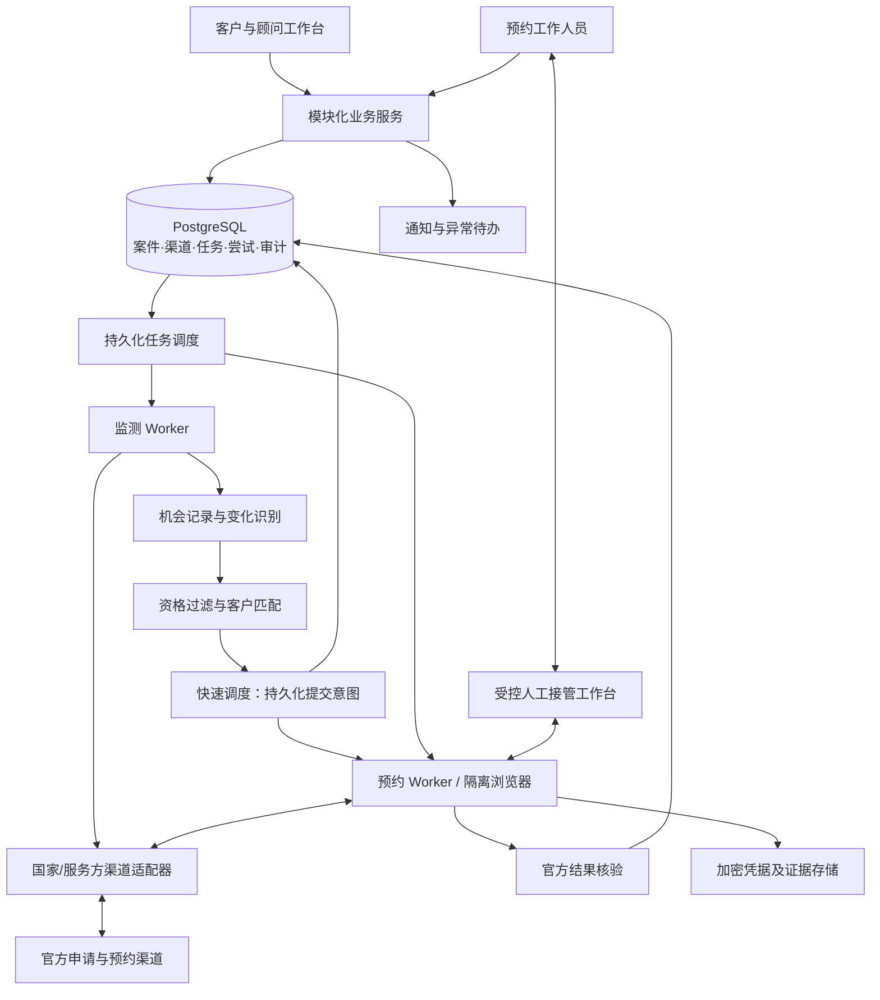

# 法国、德国、英国留学签证预约系统设计

设计日期：2026-11-19。版本：v0.2，补充瞬时放号的抢号引擎；本文件是设计方案，尚未实施渠道接入或真实预约。

## 1. 目标与已知范围

面向一家留学教育机构，为同时等待预约的 **100 人以内**客户提供“准备就绪—发现预约机会—匹配客户—预约协作—官方结果核验”的闭环。

核心竞争目标是：名额开放后，在渠道实际允许的流程和访问预算内，尽快完成首次有效发现与官方名额保留/提交。将客户筛选、会话准备和可提前完成的表单步骤移出放号后的关键路径；不能以发送提醒或排入人工队列代替抢号能力。

- 目的国：法国、德国、英国。
- 法国、德国：长期留学签证，按具体留学子类配置。
- 英国：Student visa，独立于申根及法德 D 类签证体系。
- 申请所在地：暂按中国境内设计；具体递交城市、客户常住地和领区尚未提供。
- 首版运营：单机构、多名顾问和预约工作人员；保留机构级数据隔离字段。

系统争取的是递交材料、面谈或采集生物信息的**预约机会**。预约成功、完成递交、签证获批是三个独立业务事件；不把预约回执标为签证获批，也不承诺获得名额。

## 2. 推荐方案与取舍

推荐 **常驻监测＋预备客户与会话＋事件触发的低延迟预约执行＋官方结果核验**。人工负责不可提前完成的验证、付款及异常；具体渠道的自动查询和提交能力需通过真实流程核验后开放。

三种可选方式：

1. **仅监测提醒**：接入较轻，适合公开信息或不允许代提交的渠道；但从提醒到人工响应存在延迟。
2. **抢号引擎与人工协作**：提前校验材料、授权、候选与会话；发现机会后立即唤醒已准备的执行器，直接进入官方保留/提交步骤，人工处理渠道要求的剩余验证及付款。首期推荐这种架构；逐渠道验证能否把人工操作移到放号前或官方保留名额后，剩余人工耗时必须计入抢号时窗。
3. **全流程自动预约**：只有在渠道实际提供相应能力、允许该使用方式、客户授权完整且结果可可靠核验时启用；逐操作开放，不能以一个“全自动”开关覆盖三国。

先用模块化业务服务和独立 Worker。规模增长后按浏览器资源、渠道维护和任务积压拆分，不以客户数量直接推导微服务数量。

## 3. 三国渠道与事实边界

### 3.1 法国

以 France-visas 的中国申请指引为官方路由起点。留学前置程序、申请表、服务商、递交城市和预约方式按客户类别核验，不能把教育程序预约和递签预约混为一类。

本次访问官方中国页面返回 503 / 安全检查页面，因此**尚未验证当前法国预约服务商、库存查询和自动化条件**。设计保留这些配置，但接入前须沿官方入口完成核验；不预设某家服务商或固定放号时间。

### 3.2 德国

本次已读取德国驻华使领馆“长期居留”指引。通用页面说明按主要居住地确定主管领区，并给出各领区在线预约入口；页面另列留学、研究/博士、语言班、中学等不同须知。

这些通用信息不能证明某一留学子类必然使用同一个预约流程。接入时须进一步核实留学子类、相关审核要求，以及是直接选日期、候补登记还是审核后邀请。不能把申根签证服务商入口直接套用到全部长期留学申请。

### 3.3 英国

本次已读取 GOV.UK Student visa 在线申请说明：身份核验可能通过 ID Check app，也可能需赴签证中心采集生物信息，具体由申请流程告知。

GOV.UK 签证中心目录说明先申请签证，再预约签证中心；其 China 链接当前指向 VFS Global。系统仅将实际需要线下预约、已具备前置条件的案件送入监测流程。具体城市、可选服务、费用和登录后流程仍需逐渠道验证。

### 3.4 渠道注册表

静态渠道键至少包含：`目的国＋申请所在国家＋领区＋签证子类＋中心＋实际服务方＋流程版本`。运行时再绑定账户、申请单及申请人上下文。

每条渠道维护：

- 官方来源、落地入口、最近人工核验时间、负责人、规则版本和生效区间。
- `scheduling_mode`：直接选时段、候补登记、审核后邀请、无需线下预约。
- 前置条件：申请表、审核状态、材料、申请编号、身份核验方式等。
- 可见范围：公开、账户、申请单、申请人；不能默认不同客户看到相同名额。
- 分项能力：查询、候补登记、辅助填表、提交、结果查询、改约、取消。
- 每项操作模式：授权接口、允许的网页操作、仅人工；支持与允许是两项独立条件。
- 登录/会话约束、验证码/OTP/付款环节、请求预算、官方队列和预约确认依据。
- `ACTIVE / PAUSED / DEGRADED / MANUAL_ONLY` 状态及原因。

若渠道只有候补或邀请机制，就监测候补/邀请及待办，不虚构“可抢时段”。公告是信息源，不是实时库存证据。

## 4. 总体架构

监测任务与预约任务使用不同队列和并发池，给预约核验预留预算。一个国家页面变化或浏览器崩溃不能阻塞其他国家，也不能影响顾问维护客户资料。

不同任务池仍共享账户/会话互斥规则。预约准备、提交、结果核对及人工接管期间，暂停该会话上可能刷新页面、续登、切换申请单或改变状态的监测；只有已验证互不干扰的只读查询才允许并行。

### 4.1 客户与申请模块

维护申请案件，不把“一个客户”视作“一个预约任务”。同一客户可能有多个真实申请，分别关联目的国、类别、前置条件、可接受中心、日期范围、申请编号和工作人员。

顾问先确定材料和前置步骤就绪；客户授权记录允许的中心、日期、费用上限、是否允许代提交及授权期限。改约、取消和额外付费服务单独控制。

### 4.2 监测与机会模块

监测返回结构化结果，同时保存来源、渠道版本、认证上下文、观测时间和脱敏证据引用。

公开且确实相同的数据可以合并检查；账户或申请单专属数据必须保持可见范围。监测结果归一为 `AVAILABLE / NO_SLOT / WAITLIST / INVITATION_REQUIRED / NOT_REQUIRED / AUTH_REQUIRED / CHALLENGE / RATE_LIMITED / PARSER_CHANGED / TRANSIENT_ERROR`，不得把未知错误归为无名额。

机会指纹由官方时段 ID 优先生成；没有 ID 时用渠道、中心、时间、可见范围生成内部指纹。相同指纹可能对应多个名额，不能推断数量或唯一所有权。重复轮询不重复通知；机会消失后再次开放可生成新的事件版本。

### 4.3 匹配模块

在放号前按明确规则过滤领区、签证子类、前置条件、日期范围、中心、费用、授权及会话可用性，再按最晚递交期限、等待时间等公开业务规则构建候选索引。放号后执行索引匹配与短事务复核，不扫描全部客户或现场重跑完整审核。规则版本和人工调整均留审计记录。

本系统的“分配”只表示安排哪位客户优先尝试，不表示锁定官方库存。预约前必须在该客户实际上下文重新核验。若多人等待同类机会，按照官方容量证据和适用并发规则安排；不凭一个“有号”布尔值同时给所有人提交。

### 4.4 预约协作与结果核验模块

Worker 将客户带到正确流程，按渠道开放辅助填表或提交。验证码、OTP、官方排队和付款交给授权人员处理；接管期间冻结自动操作，恢复前重新检查状态。

只有满足该渠道官方确认条件，才写入成功状态。若官方要求完成付款或后续确认才生效，先标为待付款或临时状态。通知发送成功不能替代预约成功。

通知首期可接企业微信/短信/邮件；客户通知与内部运营告警分开。当前设计不发送任何实际通知。

## 5. 核心业务流程

1. 创建申请案件，核验领区、类别、前置条件和授权；资料不全的客户进入补充材料待办。
2. 根据渠道模式进入时段监测、候补登记协作、邀请待办，或记录无需线下预约。
3. 按渠道与认证上下文运行检查，识别有效变化，并写入机会记录及匹配任务。
4. 匹配候选客户，持久化创建预约尝试；同一案件有效尝试互斥。
5. 获取账户/申请单执行租约，检查会话、客户授权、费用和机会新鲜度。
6. 核验实际可用性：若事件来自该客户同一有效上下文，且渠道支持直接以该结果提交，则不额外重复查询；若来源是其他可见范围、结果已过期或协议要求重查，则在该客户上下文查询。无号则结束本次尝试，案件继续等待。登录或验证问题进入对应待办。
7. 人工或允许的自动操作完成预约提交；任何结果不确定的提交立即进入核对流程。
8. 根据官方记录、确认编号或可验证凭据核验结果，保存加密回执，再通知客户。
9. 处理后续官方取消、客户改约、递交完成和签证审理状态；与预约状态分离。

## 6. 状态机与防重复

### 6.1 三种状态分别维护

- **案件准备状态**：资料待补充 → 待授权 → 就绪 → 办理中 → 预约已确认；另有暂停、撤回、无需预约等分支。
- **预约尝试主状态**：已分配 → 核验中 → 提交中 → 结果核对中 → 已确认、确定失败或待人工核对。待人工、待付款是可在渠道指定环节进入的暂停分支，保存恢复位置和已发生的外部操作；并非每条路线都需经历这些分支。待人工核对的尝试仍占用有效尝试约束。
- **签证办理状态**：未递交、已递交、审理中、获批、拒签、撤回；不由预约回执推断。

### 6.2 提交成功但响应丢失

这是最优先处理的故障：外站可能已预约成功，本系统却收到超时。

处理规则为：保留尝试及账户隔离状态 → 查询官方预约记录/确认凭据 → 能确认成功则记成功 → 能确定未受理且符合重试规则才重试 → 无法判断则人工核对。

不能因为任务超时、Worker 重启或锁过期，就换一个 Worker 再次提交。撤销也不是自动补偿动作，必须按渠道和客户改约/取消权限单独执行。

### 6.3 并发与幂等机制

- PostgreSQL 保存权威状态；给案件设置“至多一个有效尝试”的部分唯一约束，状态变更使用版本号或条件更新。
- 同一案件至多一张当前有效的预约确认；已确认案件禁止直接新建普通预约尝试。改约使用显式流程和独立授权，保留旧记录及结果核对，不默认先取消旧预约。
- 任务是至少一次投递；使用 `operation_id / attempt_id / event_id` 去重，任务创建和业务状态变更放在同一数据库事务。
- 账户、申请单或会话的互斥范围由渠道规则配置，不能只锁客户，也不能只锁时段指纹。
- 执行租约带续租和版本标识。旧 Worker 的内部写入可以拒绝；但无法撤回其已经发往外站的请求，因此提交中租约丢失必须先隔离和核对。
- 只有官方接口确实支持幂等键时才传递端到端幂等键。网页提交通常无法保证外部 exactly-once，不以内部锁作这种承诺。
- 同一客户跨国的不同真实申请不默认互斥；若业务约定同一目标只能获得一次预约，则显式绑定 `application_group` 并配置约束。

## 7. 渠道适配接口

业务层调用统一操作，站点差异收敛在适配器。以下为接口语义设计，并非现成官方 API：

- `capabilities(route_version)`：声明流程模式、操作能力、可见范围和权限条件。
- `check_readiness(case_context)`：返回可办理条件及需要顾问处理的阻塞项。
- `ensure_session(session_ref)`：返回就绪、需登录或需人工验证。
- `observe(route, auth_context)`：返回时段、候补/邀请状态或结构化错误。
- `prepare(attempt)`：在客户授权内准备表单和当前页面。
- `reserve(attempt)`：仅在渠道确有官方保留步骤时调用，返回绑定申请上下文的官方保留引用、状态与到期时间；保留状态不等于最终预约确认。
- `submit(attempt, operation_id)`：返回受理待核验、明确拒绝或结果不确定；普通 ACK 或进入处理队列不代表容量已分配。
- `reconcile(attempt)`：返回官方已确认、确定未受理或仍不确定，并附证据引用。
- `reschedule / cancel`：独立能力，首版可仅生成工作待办。

所有返回都带 `observed_at、route_version、auth_scope、evidence_ref`。时段保存 IANA 时区、当地日期及原始显示文本；纯日期不错误转换为 UTC 午夜，展示给工作人员时明确所在地时区。

网页适配使用确定性的字段、定位器和页面状态检查。页面格式变化时暂停对应能力并报警，不能让模型在未知页面上自行决定提交、费用或取消操作。LLM 可辅助整理公告和定位变更线索，关键交易状态以规则和官方凭据为准。

## 8. 数据模型

核心关系为：客户拥有多个申请案件；案件选择版本化渠道；一次监测产生多个机会；案件可产生多次预约尝试，但只有一个有效尝试；确认结果关联尝试和官方凭据。

- `Applicant`：机构、客户标识、联系引用；证件信息另行加密。
- `ApplicationCase`：客户、目的国、类别、领区、中心/日期偏好、最晚递交日、前置状态、案件状态、目标组和版本号。
- `Authorization`：授权主体、案件、操作范围、中心/日期、费用及币种上限、生效/失效时间、撤销时间和凭证。
- `ChannelRouteVersion`：路由维度、模式、入口、能力、限制、适配器版本、核验来源和状态。
- `AccountSession`：客户/申请范围、凭据引用、加密会话引用、过期时间、健康状态和执行租约。
- `ExecutionReadiness`：案件与授权版本、会话版本、当前流程位置、参数有效期、就绪/失效时间和执行器引用；敏感参数保存在受控加密存储。
- `MonitorJob / MonitorRun`：渠道、认证范围、计划时间、结果类型、耗时、请求计数和证据引用。
- `SlotObservation`：官方时段标识或内部指纹、渠道、认证范围、时间/时区、观察时间、失效策略及证据。
- `WaitlistRegistration / Invitation`：案件、渠道、官方候补编号、登记状态、官方核验时间、邀请标识/有效期及凭据；候补登记不记作预约成功。
- `BookingAttempt`：案件、操作类型（候补登记、邀请办理、时段预约等）、可为空的时段/候补/邀请关联、操作 ID、状态、版本、执行者、租约及结果不确定原因。无时段流程不生成虚构时段。
- `OfficialHold`：尝试、官方保留引用、绑定的账户/申请/会话范围、官方期限、当前状态和核验依据；保留令牌加密，释放或过期按官方证据处理。
- `BookingConfirmation`：官方确认编号、渠道、案件、中心、时间、付款/生效状态、官方核验时间及回执。
- `HumanTask`：接管原因、案件/尝试、办理人、接管锁、截止时间和恢复条件。
- `DurableJob / NotificationOutbox / AuditEvent`：任务重放、通知去重和操作审计。

敏感数据不直接放进任务消息；消息携带内部 ID 和短期引用。对已撤销授权的任务在执行关键操作前再次检查。对已经提交的外站请求，授权撤销触发核对和人工后续处理，不能声称本地取消即可撤回。

## 9. 调度、限流与异常降级

监测按真实认证范围合并。100 个客户可能共享一些公开检查，也可能需要 100 个独立申请上下文；不得为了省请求而错误共享登录库存。

请求预算覆盖查询、登录、表单准备、提交及结果核对。站点/服务方、渠道、账户和会话各层采用实际适用的限额；增加 Worker 不增加外站允许预算。

异常处理：

- 登录失效：停止依赖该会话的任务，生成重新登录待办。
- 反自动化挑战/禁止访问：暂停该路线或转人工，不使用多账号、代理轮换等方式突破限制。
- 限流：遵守 `Retry-After` 等明确指示，退避并降低并发；保留结果核对预算。
- 网络或服务端故障：查询操作有界重试和退避；提交操作进入核对流程。
- 页面变化：保留脱敏证据、暂停受影响操作并告警，不报告为无号。
- 通知失败：Outbox 重投并转内部待办，预约结果以数据库和官方核验为准。
- 官方队列：按该渠道队列规则处理，保持人工可见，不把排队页面解析成名额。

监测频率根据实际允许范围、会话成本和实测数据设置，不写死“所有网站每秒轮询”。若需要提高命中机会，先缩短匹配、接管和表单准备耗时，再在允许的预算内调整监测。

## 10. 低延迟抢号引擎

### 10.1 先找出真正的竞争步骤

逐渠道绘制“库存查询—选择时段—生成保留/订单—验证—付款—预约确认”的真实调用顺序，标注每步能否提前、请求往返数和副作用。仅在网站实际支持时才存在保留阶段；不能预设所有网站都有锁号接口。

- 如果选择时段并不占名额，就优化到实际原子扣减或官方容量保留/分配那一步，而非只优化页面点击。
- 如果官方会返回绑定申请人、账户或会话的保留标识和期限，尽快合法获得该保留，再在期限内完成剩余步骤。保留标识不跨客户复用；保留成功与最终预约确认分别记录。
- 如果系统是候补、邀请或官方排队，按其分配机制执行；更快的重复请求不代表能提前获得分配。

适配器明确区分 `ACCEPTED_PENDING`（收到请求但容量待核验）、`HOLD_CONFIRMED`（有官方依据证明容量已绑定该申请且暂时保留）和 `BOOKING_CONFIRMED`（最终预约有效）。若只能获得 ACK，记录为受理待核验，不能据此宣称抢到名额。

### 10.2 放号前：建立可立即执行的就绪池

`READY` 表示业务材料就绪；新增 `ARMED` 表示该客户的当前执行上下文已准备：授权与案件版本有效、会话有效、到达允许提前到达的流程位置、所需参数当前有效、执行器和连接可用。

提前完成渠道允许完成的申请步骤与表单字段，保存合法取得的流程参数和有效期引用；绑定时段或每次操作才能生成的参数仍在执行时取得。会话、参数或页面状态过期就退出 ARMED，不把登录成功当作永久可提交。

维护按渠道、中心、类别、允许日期和费用检索的有序候选池。提前完成材料核验，放号后只检查是否仍授权、仍就绪、版本未变化且没有冲突尝试。

使用常驻 Worker、有界数量的隔离浏览器上下文和会话级连接池，避免发现名额后才启动浏览器、登录或全页导航。续登和会话维护只在不干扰交易的阶段执行。就绪池容量按浏览器资源和渠道规则设置，不要求同时打开 100 个浏览器进程。

### 10.3 检测：在允许预算内提高有效采样

优先使用实际存在且允许接入的官方推送/订阅或查询方式；没有这些能力时，采用允许的查询或浏览器监测，不预设三国网站提供统一实时 API。

独立查询上下文采用固定周期与稳定相位错峰，平滑机构自身请求。故障退避可加随机偏移；随机 jitter 本身不能宣传为提高命中率，因为它也可能拉长检查间隔。

如实测发现放号集中窗口，可在允许范围内调整各窗口的采样预算，同时保留窗口外的退号和补放检查。历史规律只是调度依据，不是固定放号承诺。

每次检查带递增序号、渠道版本、会话版本和请求起止时间。默认同一上下文只有一个在途检查；旧响应不得覆盖更新结果，切换会话后旧响应失效。暂停、已进入预约尝试和人工接管状态不被后到的监测事件覆盖。

监测、会话维护、提交、结果核对分配独立预算；监测不能用尽提交额度。公开库存才可共用探测，账户专属库存仍按客户分别核验。

### 10.4 放号后：缩短关键路径

有效观测 → 查询预计算候选 → 获取账户/申请单执行权 → 短事务复核授权与案件状态并持久化意图 → 唤醒就绪执行器 → 执行渠道要求的保留/提交 → 核对结果。

放号后的路径不等待客户通知、不上传截图、不生成报表，也不进入普通后台长队列；这些动作异步执行。必要的持久化提交意图、互斥与授权复核仍在外部副作用之前完成，不能为速度省略。

使用数据库事务与提交后的即时唤醒机制，例如 PostgreSQL `LISTEN/NOTIFY`，减少等待下一轮任务扫描的延迟。唤醒信号只是提示，持久化任务和尝试记录才是事实；重启或信号丢失后按记录恢复，提交状态不明的任务先核对。

若该客户执行器已经拥有有效观察和互斥上下文，可在同一常驻执行路径内继续操作，避免不必要的跨进程转发。跨账户发现的机会仍需在目标客户上下文核验。

有两类执行适配：

- **请求级适配**：当官方接口或网页正常使用的请求确实允许接入时，沿真实流程携带当前会话、CSRF 和流程参数，复用连接，减少渲染和重复导航。接口存在不等于允许接入，令牌也不能伪造或跳过生成步骤。
- **浏览器适配**：必须使用网页流程时，保留已准备的上下文，直接操作当前正确页面；等待对应状态或响应，不用固定多秒等待代替状态判断。资源优化需经回归验证，不影响验证和必要脚本。

官方若在提交时原子检查名额，就避免额外增加不必要的“再查一次”往返；若必须先查、选或取得新令牌，则保留完整顺序。

不同合格客户可在实际渠道并发范围内有界执行；同一申请不能多 Worker 并发重提。库存数量未知时不能把一次 AVAILABLE 当作可为所有客户批量提交的容量证明。

### 10.5 验证与付款的位置决定速度上限

若验证码、OTP 或确认步骤允许在放号前合法完成且仍有效，可在准备阶段完成；若必须在放号后重新生成，就进入关键路径，计入人工响应和办理时间。不能在模型里把它当作零耗时，也不假设旧令牌能够复用。

若官方先保留名额再付款，按实际保留期限安排工作人员；若付款前不保留，就将付款耗时计入竞争时窗。无法满足时窗的渠道明确标注瓶颈，不能用“内部毫秒级”掩盖端到端不可行。

### 10.6 延迟模型与工程目标

将竞争耗时拆成：放号至下一次有效采样的等待、查询往返与解析、内部匹配/持久化/派发、必须的远端流程往返、必要验证，直到可验证的官方容量保留或分配。只有 ACK 时，终点标为受理待核验，另行跟踪至容量确认的时间。

对固定周期查询作简化分析：设间隔 `T`、名额从可查询到不能再分配的窗口 `W`、查询采样后到本机解析完成耗时 `R`、解析后到竞争请求抵达外站耗时 `L`。假设随机放号相位均匀、延迟固定、无缓存和可见范围差异，且竞争请求抵达即执行容量检查，则赶上时窗的采样机会约为 `clamp((W-R-L)/T, 0, 1)`。若请求还需在外站排队再竞争容量，则额外计入该延迟，此简化模型不能直接使用。

例如假设 `W=5 秒、T=10 秒、R+L=1 秒`，模型给出 40% 的采样机会；它不是预约成功率，也不是当前网站实测。其他人的竞争会改变 W；首次观察有号到首次观察无号的时长也不是名额完整生命周期。实际机制不满足假设时，仅将模型用于分析轮询和延迟的影响。

对会话已就绪且无人工阻塞的路线，暂设内部反应目标：从有效响应解析完成，到发出首个必需的官方请求，p95 ≤100ms、p99 ≤250ms。此目标包含本地匹配、短事务和派发，需在选定部署与实测负载下验证；不包含轮询等待和外站响应。

“解析完成到真正竞争请求发出”是另一项指标：如果还需取得新令牌、选号或完成其他远端步骤，就包含这些往返并按渠道实测。仅当下一步可直接发出竞争请求时，也对这一整段采用上述 100ms 目标。两项指标不能混用。

外部往返与完整观察至官方容量保留/分配耗时分别实测，不承诺三国统一亚秒完成。计时使用单调时钟，跨节点记录时钟误差；总链路分位数直接测量，不能把各段 p95 相加冒充总 p95。

### 10.7 抢号专用验收

记录计划检查、实际检查、请求发出、响应收到、解析完成、候选选定、意图持久化、执行器接收、竞争请求发出、官方应答和最终确认时间。人工介入、保留过期、限流、页面变化和登录失效单列。

在本地模拟站点构造短暂开放、快速售罄、保留过期、过期令牌、旧响应乱序和提交响应丢失。验证关键路径延迟、可恢复性和不重复提交；这些实验不用于推断真实站点成功率。

根据“有机会且有合格客户 → 会话已就绪 → 竞争请求及时发出 → 受理待核验 → 官方容量保留/分配 → 最终确认”的同批事件漏斗定位瓶颈，区分检测不及时、未就绪、人工等待、网络往返与官方竞争失败。按实际渠道允许跳过不存在的阶段，绝不以 ACK 代替容量确认。

## 11. 容量与技术选型

### 11.1 首期建议

- 后台：Python＋Django/DRF，按客户、渠道、监测、预约、通知拆模块。
- 工作台：Django Admin 处理档案和规则，定制机会列表、任务队列、人工接管和异常处理页面。
- 持久化：PostgreSQL，同时承载耐久任务队列，使用短事务及 `SKIP LOCKED` 领取；副作用任务仍遵守结果核对规则。
- Worker：独立 Python 进程；允许的网页自动化使用 Playwright，每个申请会话隔离、加密持久化。
- Redis：可选，作短期缓存和分布式限流；不保存唯一预约事实。单实例首版可先用数据库协调。
- 文件：加密对象存储保存必要回执及脱敏证据；密钥由部署平台密钥服务管理。
- 运维：Docker 部署、TLS、集中日志、指标与告警；首版无需 Kafka 或 Kubernetes。

核心服务、数据库和浏览器 Worker 分开部署或至少独立资源限制。浏览器进程故障不影响数据库与运营后台。首版可单应用实例，但必须有数据库备份、恢复演练和 Worker 自动恢复；生产可用性要求更高时再增加冗余。

### 11.2 容量公式

监测请求率估算：`Q_monitor = Σ(k_i / T_i)`，其中 `k_i` 是某认证范围每轮实际请求数，`T_i` 是允许且配置的检查间隔（秒）。

总请求需求还要加登录、准备、提交和核对请求。不能用客户数直接估算请求量，也不能用服务端 QPS 能力替代渠道预算。

浏览器并发估算：`B ≈ ceil(浏览器任务到达率 × 平均占用秒数 / 目标利用率)`。人工等待和官方队列可能长期占用会话，需单独统计；首期以有界小并发起步，使用真实流程压测后配置资源。

人工需求按峰值到达率、平均办理时长和实际值守人数计算。名额存续很短时，人工响应可能是主要瓶颈；“监测很快”不等于“能及时约到”。候补/邀请渠道则使用不同的办理时限。

费用主要受账户专属检查量、浏览器运行时长、通知量、适配器维护和人工值守影响。未确定城市、渠道能力和运行数据前不做精确服务器报价或成功率估计。

## 12. 权限、数据与授权

- 顾问维护分配给自己的案件；预约人员只见办理所需数据；渠道管理员维护规则；审计人员查看操作和脱敏证据。
- 机构、角色、案件范围共同授权；完整护照和回执按需展示，导出与敏感查看留记录。
- 账户密码、Cookie、护照和材料分开保管，静态加密，Worker 按案件获得短期访问引用。
- 截图、日志、报错和通知默认脱敏；不记录密码、OTP、完整 Cookie 和整页敏感表单。
- 人工接管需校验权限，冻结自动操作并记录接管和恢复事件；不提供公开、无认证的远程浏览器入口。
- 数据保留、删除、授权到期及材料导出规则配置化。密钥与数据库备份分别保护，定期验证恢复。
- 首次接入逐操作核验服务方使用条件、客户授权和允许的代理方式，形成渠道记录；这直接决定自动化模式。

## 13. 指标与验收

### 13.1 业务指标

- 有效监测覆盖率：运行且最近成功核验的应监测上下文 / 应监测上下文。
- 机会处理耗时：本系统观察到有效机会至匹配、接管、提交的分段耗时。
- 官方确认率：按提交日期、操作类型和渠道固定一批尝试，在明确观察窗口内统计其中获得官方确认的数量 / 该批全部已提交尝试；未决数量和窗口长度同时展示。候补登记确认率单列，不混入预约确认率。
- 案件预约完成率：按进入办理日期固定一批就绪案件，在明确观察窗口内统计其中获得有效预约的案件数 / 该批全部案件数，注明类别、中心、窗口长度和仍在等待的数量；历史案件的本期成功不混入新批次分子。
- 结果不确定积压、人工待办超时、重复提交/重复有效预约、错误分类、通知送达和渠道故障。

无法获知真实放号时间时，不报告“放号到发现延迟”；用首次观测时间作为明确起点。周期指标不能隐藏尚在等待的客户。

### 13.2 建议的内部目标

抢号内部路径采用第 10.6 节的 p95 ≤100ms、p99 ≤250ms 待验证目标，替代 v0.1 的“匹配和建任务 p95 在 5 秒以内”。无外部依赖的普通后台查询目标仍为 p95 在 1 秒以内。渠道查询、人工接管、竞争请求和官方确认各自建立基线。工作时段外的人工模式明确显示值守状态；需要放号后人工操作的路线须评估该时段是否具备办理能力。

### 13.3 必测场景

1. 正常无名额、有效时段、候补、邀请、无需预约五种模式正确分流。
2. 登录过期、限流、验证码、页面变化和服务故障均不误报成无名额。
3. 同一监测事件或任务重复投递，不重复建有效尝试或重复发同一通知。
4. 提交成功后响应丢失、提交中 Worker 崩溃、租约过期，均进入核对且不盲目重提。
5. 人工接管与自动任务互斥，恢复时不覆盖人工进度。
6. 名额消失、官方容量未知、账户可见范围不同和多人竞争时正确降级。
7. 授权撤销、费用超限、中心不符、领区不符时，关键操作被阻止并转待办。
8. 官方取消、客户改约、付款未完成与回执确认状态正确分离。
9. 权限隔离、截图脱敏、通知重试、数据库及凭证恢复通过演练。

适配器用脱敏页面样本和契约测试回归；副作用流程使用本地模拟站点或服务方允许的测试环境，不通过对真实生产预约反复提交来压测。

## 14. 落地顺序与阶段出口

**阶段一：渠道摸底。** 三国分别确认首个递交城市、留学子类、官方路径、前置要求、模式、授权条件及核验方式，填写渠道注册表。出口是每条路线有负责人、有证据，未知项不会被标为已支持。

**阶段二：最小抢号闭环。** 实现档案与授权、客户预计算、会话就绪池、常驻监测、低延迟执行和结果核验；在模拟环境验证短暂放号及故障场景。先以一条具备条件的真实路线验证查询和官方受理链路；仅有通知提醒不作为抢号能力验收通过。

**阶段三：扩至三国首批路线。** 每国按已选城市/类别接入，验证不同认证上下文、候补/邀请模式和运营值守。对不能可靠自动查询的路线明确显示人工模式。

**阶段四：逐渠道开放辅助填表/自动提交。** 以实际允许、完整授权、可核验结果和故障验收通过为入口条件；随时能停用单项自动化并回落人工。

首期交付物包括工作台、渠道规则与适配器、持久化任务/状态机、告警、核验凭据和运维手册。工期在阶段一后按实际可自动化路线估算；新城市或服务商变更视作新路线验收，不只改一段 URL。

## 15. 设计评审后需要补充的参数

1. 各国首期递交城市及客户主要居住地分布。
2. 留学子类和前置流程：例如大学、博士、语言班、中学等是否都覆盖。
3. 可用的客户授权方式、申请账户准备情况和脱敏流程样本。
4. 人工值守时段、接管响应能力、费用上限及是否接受收费时段。
5. 是否已有 CRM、开发团队技术栈和部署/数据存储要求。

以上参数会改变适配器、资源预算和运营方式；不影响当前的模块划分与结果核对原则。

## 16. 官方来源与核验记录

- [GOV.UK：Student visa](https://www.gov.uk/student-visa)，2026-11-19 读取，用于确认英国独立签证体系。
- [GOV.UK：Student visa — Apply online](https://www.gov.uk/student-visa/apply-online)，同日读取，用于确认身份核验方式由申请流程确定。
- [GOV.UK：Find a visa application centre](https://www.gov.uk/find-a-visa-application-centre)，同日读取，用于确认先申请再预约；China 链接为 [VFS 中国英国签证中心入口](https://visa.vfsglobal.com/chn/en/gbr/attend-centre)。本次未验证其登录后预约能力。
- [德国驻华使领馆：长期居留](https://china.diplo.de/cn-zh/service/visa-einreise/nationales-visum-1345434)，同日读取并展开预约说明和留学类别，用于确认领区及类别分流；尚未核验特定客户的学生预约流程。
- [France-visas：中国](https://france-visas.gouv.fr/chine)，同日访问返回 503 / 安全检查，无法据此确认当前服务商和预约条件，留作接入核验入口。

上述来源用于路由设计，不构成当前名额、固定放号规律、代理权限或自动化可用性的证明。
